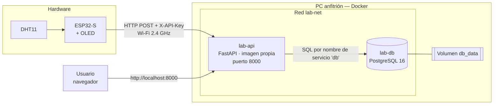

# Lab Climate Monitor

Monitoreo de temperatura y humedad del laboratorio de Sistemas Digitales con una ESP32, una API REST en FastAPI y una base de datos PostgreSQL, todo desplegado con Docker y Docker Compose.

Proyecto de aula de **SD1005 – Sistemas Operativos (2026-II)**, Institución Universitaria Pascual Bravo.
Autores: Juan Manuel Meneses Zapata y Santiago Castellón Cano.

## Problema

En el laboratorio de Sistemas Digitales hay equipos y componentes electrónicos que se ven afectados por el calor y la humedad, y hoy nadie lleva un registro de esas condiciones. Si un equipo falla o un componente se daña, no hay datos para saber si el ambiente tuvo algo que ver.

## Solución

Una ESP32 con un sensor DHT11 mide la temperatura y la humedad cada 10 segundos y las envía por Wi-Fi a una API que corre en un contenedor Docker. La API valida los datos, los guarda en PostgreSQL y los muestra en un panel web con gráfica. También permite descargar todo el historial en CSV.

## Arquitectura



| Servicio | Imagen | Función | Puerto publicado |
|---|---|---|---|
| `api` | `lab-climate-api` (construida con el Dockerfile de `api/`) | Recibe, valida y sirve las lecturas, y el panel web | 8000 |
| `db` | `postgres:16-alpine` | Guarda las lecturas | Ninguno (solo accesible dentro de la red `lab-net`) |

## Estructura del repositorio

```
lab-climate-monitor/
├── api/
│   ├── Dockerfile          # imagen propia de la API
│   ├── .dockerignore
│   ├── main.py             # API REST (FastAPI + SQLAlchemy)
│   ├── requirements.txt
│   └── static/index.html   # panel web
├── firmware/lab_sensor/
│   ├── lab_sensor.ino      # código de la ESP32
│   └── secrets.example.h   # plantilla de credenciales
├── docs/                   # diagrama y evidencias
├── compose.yaml
├── .env.example            # plantilla de variables de entorno
└── README.md
```

## Requisitos

- Docker Desktop (o Docker Engine con el plugin de Compose).
- Git.
- Para la parte física: ESP32, sensor DHT11, pantalla OLED SSD1306 (opcional) y Arduino IDE.

## Ejecutar desde cero

1. Clonar el repositorio:

   ```bash
   git clone https://github.com/JuanMeneses921/lab-climate-monitor.git
   cd lab-climate-monitor
   ```

2. Crear el archivo `.env` a partir de la plantilla y cambiar los valores:

   ```bash
   cp .env.example .env
   ```

   En Windows PowerShell: `Copy-Item .env.example .env`

   | Variable | Para qué sirve |
   |---|---|
   | `POSTGRES_DB` | Nombre de la base de datos |
   | `POSTGRES_USER` | Usuario de PostgreSQL |
   | `POSTGRES_PASSWORD` | Contraseña de PostgreSQL (solo letras y números) |
   | `API_KEY` | Clave que debe enviar la ESP32 para poder guardar lecturas |

3. Construir y levantar los servicios:

   ```bash
   docker compose up -d --build
   ```

4. Abrir:
   - Panel web: <http://localhost:8000>
   - Documentación interactiva de la API: <http://localhost:8000/docs>

## Probar sin la ESP32

Se puede enviar una lectura a mano, como si fuera la placa (cambiar la clave por la del `.env`):

```powershell
Invoke-RestMethod -Method Post -Uri http://localhost:8000/api/readings -Headers @{"X-API-Key"="TU_API_KEY"} -ContentType "application/json" -Body '{"device_id":"esp32-lab","temperature":24.5,"humidity":60}'
```

Con `curl`:

```bash
curl -X POST http://localhost:8000/api/readings -H "X-API-Key: TU_API_KEY" -H "Content-Type: application/json" -d '{"device_id":"esp32-lab","temperature":24.5,"humidity":60}'
```

## Endpoints de la API

| Método | Ruta | Descripción | Requiere clave |
|---|---|---|---|
| GET | `/` | Panel web con gráfica | No |
| GET | `/health` | Estado del servicio | No |
| POST | `/api/readings` | Registrar una lectura | Sí (`X-API-Key`) |
| GET | `/api/readings?limit=50` | Últimas lecturas (máx. 500) | No |
| GET | `/api/readings/latest` | Lectura más reciente | No |
| GET | `/api/readings/export.csv` | Descargar todo el historial | No |

## Configurar la ESP32

1. Conexiones:

   | Componente | Pin | ESP32-S |
   |---|---|---|
   | DHT11 | DATA | GPIO 4 |
   | OLED | SDA | GPIO 21 |
   | OLED | SCL | GPIO 19 |
   | Ambos | VCC / GND | 3V3 / GND |

2. Copiar `firmware/lab_sensor/secrets.example.h` como `secrets.h` y completar el Wi-Fi (2.4 GHz), la IP del PC que corre Docker y la `API_KEY`.
3. En Arduino IDE instalar las librerías *DHT sensor library*, *Adafruit SSD1306* y *Adafruit GFX*, elegir la placa **NodeMCU-32S** o **ESP32 Dev Module** y subir el código.
4. En Windows, permitir el puerto 8000 en el firewall (PowerShell como administrador):

   ```powershell
   New-NetFirewallRule -DisplayName "Lab Climate API 8000" -Direction Inbound -Protocol TCP -LocalPort 8000 -Action Allow
   ```

## Comandos de operación

| Acción | Comando |
|---|---|
| Ver estado | `docker compose ps` |
| Ver logs de la API | `docker compose logs api --tail 20` |
| Seguir logs en vivo | `docker compose logs -f api` |
| Detener | `docker compose stop` |
| Reiniciar | `docker compose start` o `docker compose restart` |
| Bajar los contenedores (los datos quedan en el volumen) | `docker compose down` |
| Revisar la red | `docker network inspect lab-climate-monitor_lab-net` |
| Revisar volúmenes | `docker volume ls` |

> `docker compose down -v` también borra el volumen y con él todas las lecturas. No usarlo salvo que se quiera empezar de cero.

## Persistencia

Las lecturas viven en el volumen `db_data`, montado en `/var/lib/postgresql/data` del contenedor `lab-db`. Para comprobarlo:

```bash
docker compose down
docker compose up -d
```

Al abrir `http://localhost:8000/api/readings` las lecturas siguen ahí, aunque los contenedores se hayan destruido y creado de nuevo.

## Acceso público (opcional)

El proyecto se evalúa en local, pero se puede publicar el panel en internet mientras los contenedores estén corriendo. Para eso hay un tercer servicio, `tunnel`, que usa la imagen oficial de Cloudflare (`cloudflared`) y crea un túnel HTTPS hacia la API sin abrir puertos en el router.

Está en un *profile* de Compose, así que no arranca con el `up` normal:

```bash
docker compose --profile public up -d
docker compose logs tunnel
```

En los logs aparece una URL del tipo `https://algo-aleatorio.trycloudflare.com`. Ese link abre el mismo panel desde cualquier celular o computador.

- El túnel llega a la API por la red interna (`http://api:8000`), igual que cualquier otro servicio.
- La URL cambia cada vez que el contenedor se reinicia (túnel rápido, sin cuenta).
- Solo funciona mientras el PC y los contenedores estén encendidos.
- Leer datos es público; escribir sigue exigiendo `X-API-Key`.

Para apagarlo sin tocar lo demás: `docker compose --profile public stop tunnel`.

## Seguridad

- Las credenciales van en `.env` y `secrets.h`, que están en `.gitignore`. En el repositorio solo hay plantillas.
- Guardar lecturas exige la cabecera `X-API-Key`; la comparación usa `secrets.compare_digest`.
- Pydantic valida cada lectura (rangos de temperatura y humedad, formato del `device_id`).
- SQLAlchemy genera consultas parametrizadas, lo que evita inyección SQL.
- PostgreSQL no publica puertos: solo la API lo alcanza por la red interna.
- La API corre como usuario sin privilegios (`appuser`) dentro del contenedor.
- Las respuestas incluyen cabeceras `X-Content-Type-Options`, `X-Frame-Options` y `Referrer-Policy`.
- El panel escribe los datos con `textContent`, nunca como HTML.
